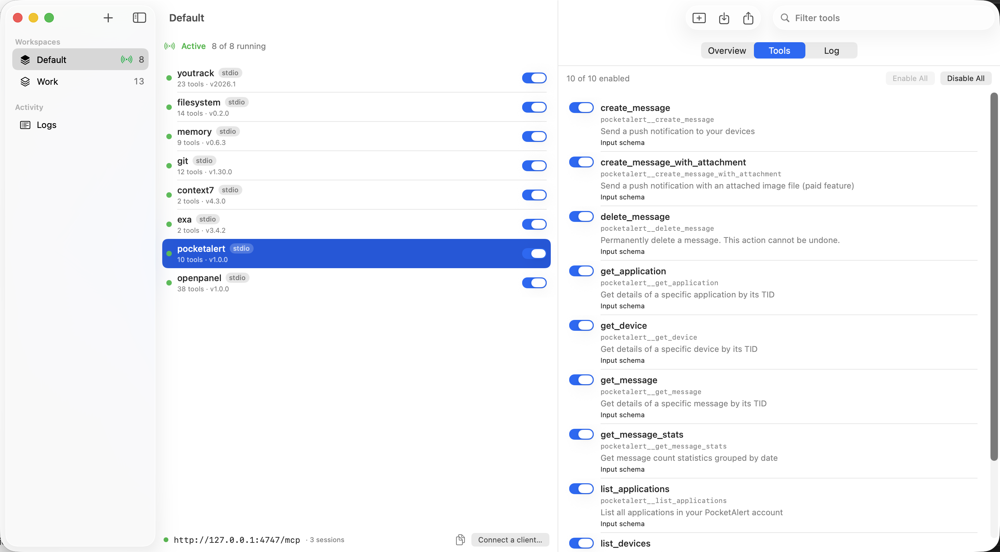

<div align="center">


# TULMA

**Tool Unifier for LLM Agents**

A native macOS menu bar app that runs all your MCP servers behind one local endpoint.


<br>



</div>

---

Every AI client keeps its own MCP config, and each one starts its own copies of the same servers. Tulma runs the servers once and serves them to every client at `http://127.0.0.1:4747/mcp`. You group servers into **workspaces** ("Work", "Personal", "Client X"). When you switch workspaces from the menu bar, connected clients get `tools/list_changed` and pick up the new tool set without reconnecting.

```
Claude Code ────┐                                        ┌── github    (stdio · npx)
Cursor ─────────┼── http://127.0.0.1:4747/mcp ── Tulma ──┼── postgres  (stdio · uvx)
Claude Desktop ─┘                                        └── linear    (Streamable HTTP)
```

## Features

- **One endpoint for every client.** Streamable HTTP for clients that support it, and a stdio bridge (`tulma connect`) for those that don't.
- **Workspaces.** Switch the whole tool set in one click. Only the active workspace's servers run.
- **Namespaced tools.** Tools are exposed as `server__tool` (64 characters at most). Name collisions get a deterministic `_2`, `_3` suffix.
- **Per-tool switches.** Hide individual tools from clients without removing the server.
- **Supervision.** Servers restart automatically with backoff (1, 2, 4, 8, 16 s, then they stay in the error state). On quit, each server's whole process group is killed, so `npx` grandchildren don't outlive it.
- **Secrets in the Keychain.** Env vars and headers whose key matches `token|secret|key|password|auth` are stored in the macOS Keychain. `config.json` only keeps a reference.
- **Import.** Paste or drop configs from Claude Desktop, Cursor or VS Code.
- **Export.** Download a workspace as an `mcpServers` JSON, with or without secrets.
- **Logs.** Tool calls, lifecycle events and server stderr go to SQLite, with secret redaction and a retention limit.
- Prompts and resources are proxied as well as tools.

## Requirements

| | |
|---|---|
| macOS | 15 or later, Apple silicon |
| Xcode | 27 or later |
| Rust | 1.98 or later (`rustup`) |
| XcodeGen | `brew install xcodegen` |
| Signing | an "Apple Development" certificate (a free Apple ID works), or ad-hoc signing (see below) |

There are no prebuilt binaries yet. Build from source.

## Build and install

```sh
git clone https://github.com/<owner>/tulma.git
cd tulma
```

### 1. Set up signing

Your team ID goes in `Config/Local.xcconfig`. The file is gitignored, so it never ends up in the repo.

```sh
echo 'DEVELOPMENT_TEAM = YOUR_TEAM_ID' > Config/Local.xcconfig
```

To find your team ID, add your Apple ID in **Xcode → Settings → Accounts** and create an Apple Development certificate. The `OU=` field of the certificate is the team ID:

```sh
security find-certificate -c "Apple Development" -p | openssl x509 -noout -subject
```

**No Apple account?** Sign ad-hoc instead:

```sh
printf 'CODE_SIGN_IDENTITY = -\nDEVELOPMENT_TEAM =\n' > Config/Local.xcconfig
```

Ad-hoc builds work, but the signature changes on every build. macOS then asks for Keychain access again after each rebuild. A stable "Apple Development" signature avoids that.

### 2. Build

```sh
make app    # cargo build --release + xcodegen + xcodebuild (Release)
make run    # build and open the app
```

The app ends up in `build/Build/Products/Release/Tulma.app`. To install it:

```sh
cp -R build/Build/Products/Release/Tulma.app /Applications/
```

The Rust daemon is built by an Xcode build phase and bundled at `Tulma.app/Contents/Helpers/tulma`. The Xcode project is generated from `project.yml`, so don't edit `Tulma.xcodeproj` by hand. It is gitignored.

## Connect clients

| Client | Setup |
|--------|-------|
| Claude Code | `claude mcp add --transport http tulma http://127.0.0.1:4747/mcp` |
| Cursor | `{"mcpServers": {"tulma": {"url": "http://127.0.0.1:4747/mcp"}}}` |
| Claude Desktop (stdio only) | `{"mcpServers": {"tulma": {"command": "/Applications/Tulma.app/Contents/Helpers/tulma", "args": ["connect"]}}}` |

**Connect a client…** in the window footer shows these snippets with the real paths filled in. `tulma connect` reads the endpoint URL from `endpoint.json`. You can override it with `--url`. The port can be changed in Settings.

## Import and export

### Import

Use **File → Import… (⌘I)**, or drop a `.json` file on the server list. Accepted shapes:

- `{"mcpServers": {...}}` (Claude Desktop, Cursor, Claude Code)
- `{"mcp": {"servers": {...}}}` (VS Code settings)
- `{"servers": {...}}` (VS Code `mcp.json`)
- a bare map of servers

Comments and trailing commas (JSONC) are fine. `command` can be a string or an array. `type`/`transport` can be `stdio`, `http`, `sse` or `streamable-http`. The preview marks each entry as new, duplicate (skip or replace) or invalid before anything is written.

### Export

Use **File → Export… (⇧⌘E)**, the export button in the server list toolbar, or right-click a workspace → **Export…**. You get an `mcpServers` JSON that Claude Desktop, Cursor and Tulma's own import can read. Copy it, or save it to a file.

- **By default, secrets are not exported.** Keychain-backed values are left empty, and tokens inside URLs and arguments (`?token=…`, `--api-key …`, `Bearer …`) are masked as `***`. The file is safe to share.
- **Include secrets** writes the real values, for moving a workspace to another Mac. Treat that file like a password.
- Disabled servers are exported with `"disabled": true`. Per-tool switches are Tulma-specific, so they are not exported.

## Security notes

- The endpoint listens on `127.0.0.1` only and rejects foreign `Host`/`Origin` headers, which blocks DNS-rebinding attacks from web pages.
- Secret values never leave the Keychain except to start a server, to show them in the server editor, or in an export with **Include secrets** turned on.
- Logs and stderr are redacted: bearer tokens and `token=`/`key=`/`password=` style values are masked before they are stored.
- Servers run with your user's permissions, like they do when a client starts them. Only add servers you trust.

## Data

Everything lives in `~/Library/Application Support/Tulma/`:

| File | Contents |
|------|----------|
| `config.json` | workspaces, servers, settings (secrets are `keychain:<uuid>` references) |
| `logs.sqlite` | tool calls, events, server stderr |
| `tool-cache.json` | last known tool lists, shown while a server is offline |
| `endpoint.json` | current endpoint URL, read by `tulma connect` |
| `daemon.log` | daemon log |

Secrets are stored in the login Keychain under the service `app.tulma`.

## Development

```sh
make test   # cargo test + Swift tests (the Swift tests start the real daemon)
make icons  # re-render the app and menu bar icons from docs/icon/*.svg (needs `brew install librsvg`)
```

You can run the daemon without the app. It reads JSON-RPC from stdin and writes responses to stdout:

```sh
make core-debug
TULMA_LOG=debug core/target/debug/tulma daemon --data-dir /tmp/tulma-dev --memory-secrets
```

Then type requests such as `{"jsonrpc":"2.0","id":1,"method":"state.get"}`. The full protocol is in [docs/control-protocol.md](docs/control-protocol.md).

| Variable | Effect |
|----------|--------|
| `TULMA_DATA_DIR` | data directory for the app and the daemon. Use it to run a dev build next to an installed one |
| `TULMA_DAEMON` | daemon binary the app launches (default `Contents/Helpers/tulma`) |
| `TULMA_LOG` | daemon log filter (`info,rmcp=warn` by default), written to stderr and `daemon.log` |

### Layout

```
core/                       Rust workspace
  crates/tulma-core         model, store (+Keychain), env (login-shell PATH), import/export,
                            upstream supervisor, catalog, gateway (rmcp), http (axum),
                            logs (SQLite), control (app ↔ daemon), bridge (stdio ↔ http)
  crates/tulma              binary: `tulma daemon` | `tulma connect`
Tulma/                      SwiftUI app: DaemonClient actor, AppStore, views
TulmaTests/                 Swift Testing: protocol, store, real daemon round trip
Config/                     signing xcconfig (Local.xcconfig is yours and gitignored)
docs/control-protocol.md    NDJSON JSON-RPC protocol between the app and the daemon
docs/icon/                  SVG sources of the app and menu bar icons
project.yml                 XcodeGen spec
```

The app owns the UI only. The daemon (`tulma daemon`) is a child process that owns all state, the servers and the HTTP endpoint. The two talk NDJSON JSON-RPC over the daemon's stdin/stdout. When the app quits, it closes stdin, and the daemon stops every server and exits.

## Troubleshooting

**`npx: command not found` or `uvx: command not found`.** GUI apps start with a minimal `PATH`. The daemon reads `PATH` once from `$SHELL -lic` (with a 1.5 s timeout) and adds the usual tool directories: `~/.local/bin`, the nvm default, cargo, bun and Homebrew. If your shell init is slow or prints errors, put the full path in the server's `command`.

**A remote server won't connect.** Tulma speaks Streamable HTTP. For servers that only support legacy SSE, wrap them in `npx mcp-remote <url>` as a stdio server.

**The port is busy.** Change it in Settings. `tulma connect` reads the current URL from `endpoint.json` each time it starts, so stdio clients only need a restart. HTTP clients need the new URL in their config.

**Keychain prompts after every rebuild.** You are signing ad-hoc. Set up an "Apple Development" certificate (see [Set up signing](#1-set-up-signing)).

## License

[MIT](LICENSE)
